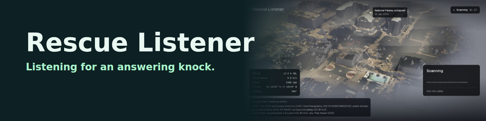
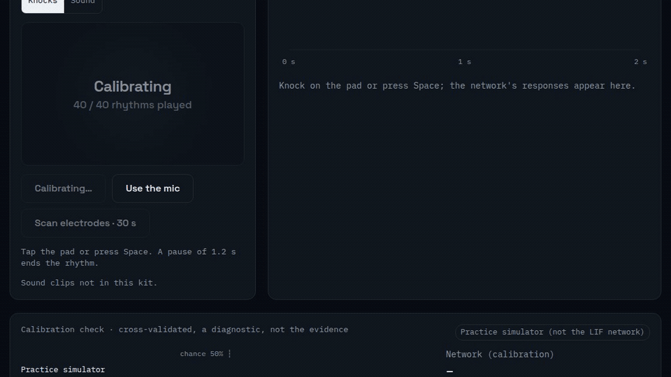
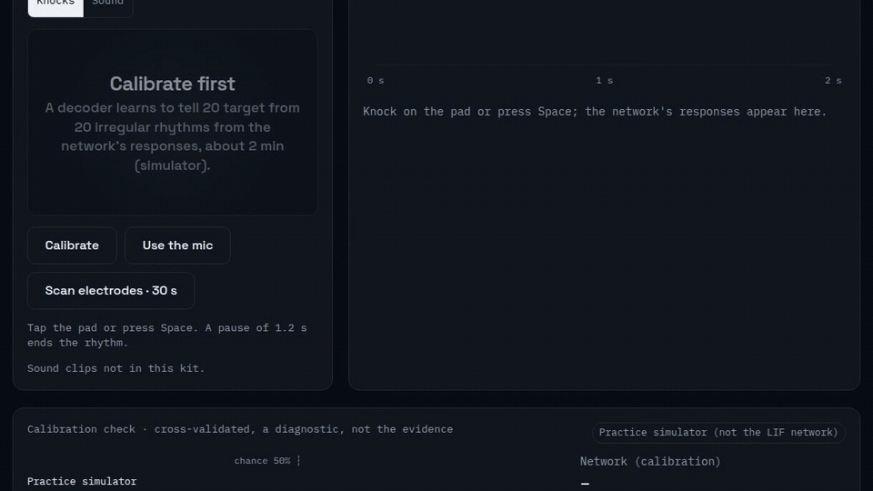
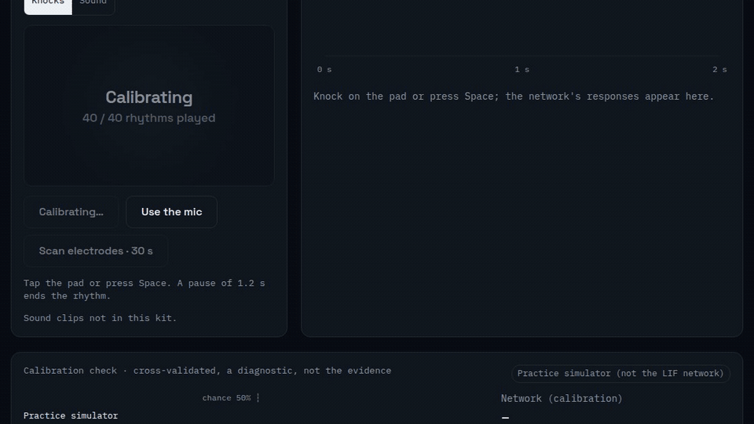
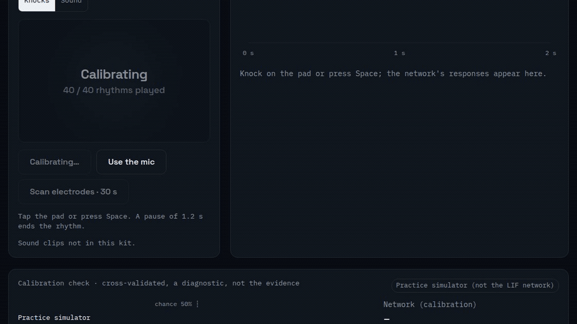
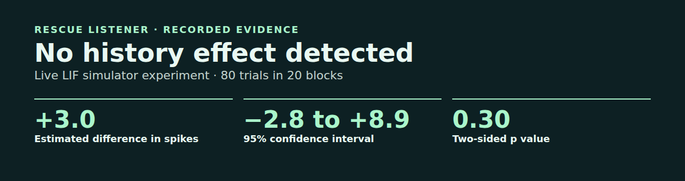
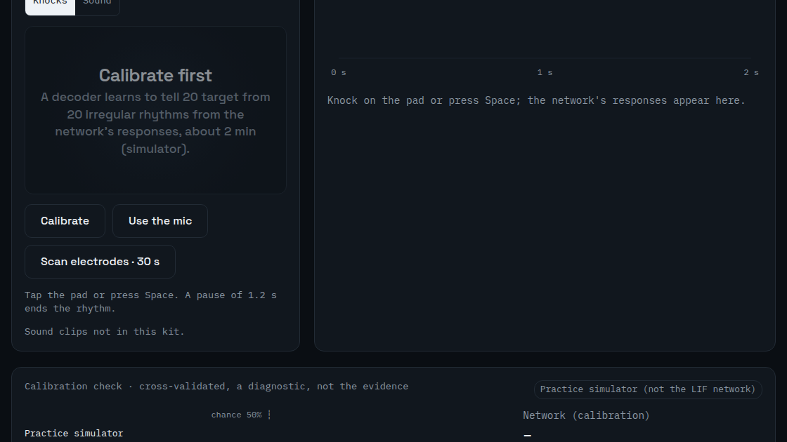
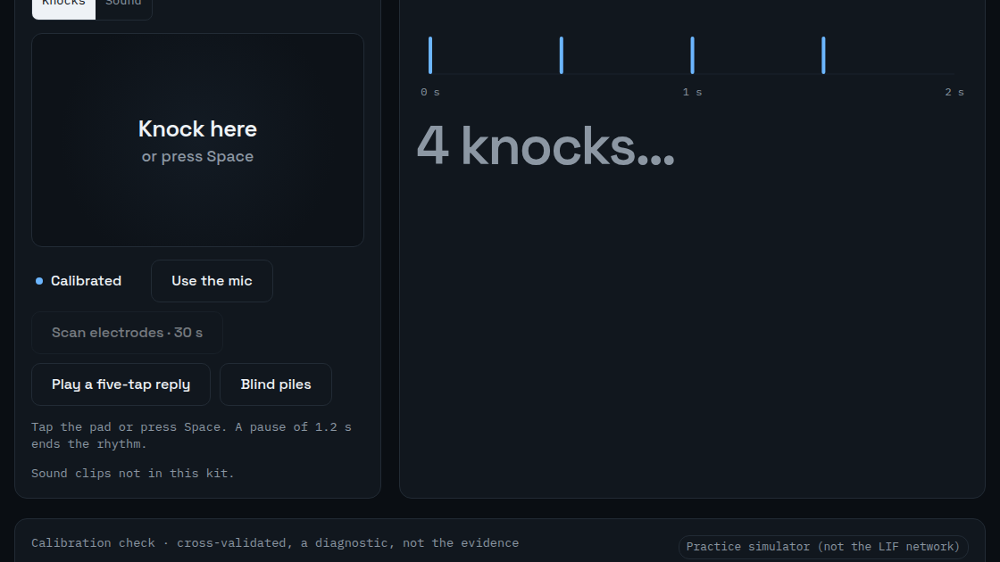
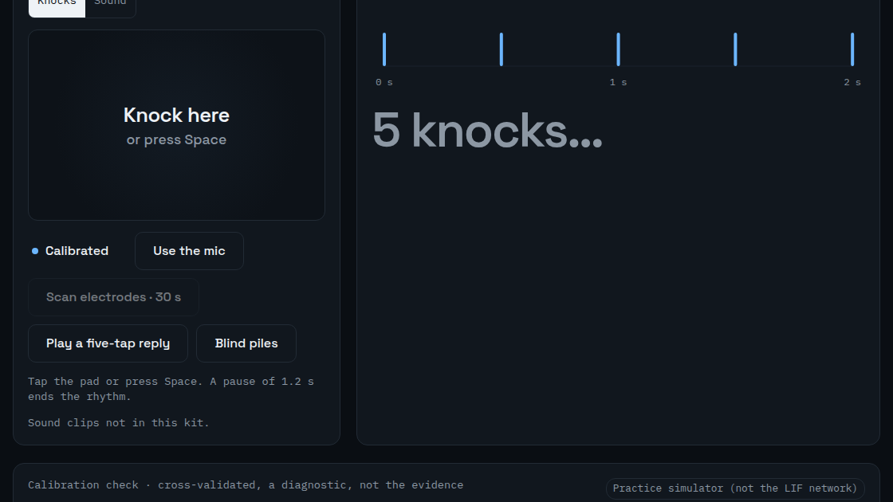

# Rescue Listener

[](biocomp-spine/pyproject.toml)
[](smoke.sh)
[](DEMO.md)

A deliberate knock under rubble can be hard to distinguish from settling debris. Rescue Listener explores that listening problem with a simulated spiking network, a decoder and a 3D rubble scene. The app shows its verdict beside a timing-only software baseline and a shuffled-label check.

In the recorded 80-trial live simulator experiment, two stimulation histories produced an estimated difference of **+3.0 spikes** on the identical final pulse. The 95% interval crossed zero, so the trial detected no history effect. [Recorded result and chart](https://atilade.uk/projects/biocomputing-hack)

Built for the Outlier Labs Biocomputing Hack in London on 3 November 2026, where it placed **second**. The event demo ran on the organisers' 64-neuron LIF simulation. The repository also includes a separate practice simulator, and the reported result applies to the simulated conditions.

**[Run the interactive simulator](#installation)** · **[Watch the practice-simulator walkthrough](docs/assets/simulator-demo.mp4)**



<sub>Real Rescue Listener screen, captured on the local practice simulator with accelerated calibration and scripted taps. The capture is cropped to the controls.</sub>

## How it works

1. **Calibrate the decoder.** Feed labelled examples of even and irregular rhythms to the network and use the responses to calibrate the classifier. The calibration panel shows a shuffled-label check beside the score (`biocomp-spine/rhythm.py`, `biocomp-spine/live.py`).

   

2. **Send five knocks.** Tap the pad or press Space to submit a rhythm. The browser sends the captured intervals to the local server, and the rubble scene shows what the system is listening to (`biocomp-spine/rhythm.html`, `rescue-scene/main.js`).

   

3. **Read the verdict beside its control.** The app shows how the decoder classified the response beside the software timing check. Blind piles let the audience pick the hidden targets and reveal them once the network has made its calls (`biocomp-spine/live.py`, `biocomp-spine/piles.py`).

   

## Results



The pre-registered test used 80 trials in 20 blocks on the organisers' LIF simulator. An omitted-pulse control separated the activity left by each history from the response to the final pulse. The reported estimate is +3.0 spikes (95% CI −2.8 to +8.9, p = 0.30). **ESTIMATE** · [Recorded run](https://atilade.uk/projects/biocomputing-hack) · [Method and practice controls](biocomp-spine/README.md#probe-omission-experiment-pre-registered-the-primary-result)

| Calibration | Knock pad | Simulator verdict |
| --- | --- | --- |
|  |  |  |

## Installation

You need Git and [uv](https://docs.astral.sh/uv/). The first setup downloads pinned Python and packages. The practice simulator runs offline after that.

```sh
git clone https://github.com/atiladeokegab/rescue-listener.git
cd rescue-listener
./setup.sh                                         # Set up both Python components
./smoke.sh                                         # Check the spine and browser screen
uv run --directory biocomp-spine python live.py --rhythm  # Serve the local practice demo
```

Open [localhost:8777](http://localhost:8777), calibrate, then give the pad five evenly spaced knocks. For the event's LIF simulator and Windows instructions, see [DEMO.md](DEMO.md).

## Documentation

[Spine, controls and experiment](biocomp-spine/README.md) · [3D scene](rescue-scene/README.md) · [Audio data and sources](rescue-data/README.md).

## Contact

Open an [issue](https://github.com/atiladeokegab/rescue-listener/issues) with the simulator mode and the visible result. Atilade Oke ([GitHub](https://github.com/atiladeokegab), [LinkedIn](https://www.linkedin.com/in/atiladeoke/)).

## Contributing

Run `./smoke.sh` and identify which simulator produced any new result or screenshot.

## Citation

```bibtex
@software{rescue_listener_2026,
  title = {Rescue Listener},
  year = {2026},
  url = {https://github.com/atiladeokegab/rescue-listener}
}
```

## License

Contact the maintainers for terms on the project code. The [recorded knocks](rescue-data/CREDITS.md) are CC BY 4.0. The scene uses public-domain Haiti LiDAR, CC BY 4.0 aerial imagery and drone model, and a CC0 sky. [Scene sources and credits](rescue-scene/README.md).
